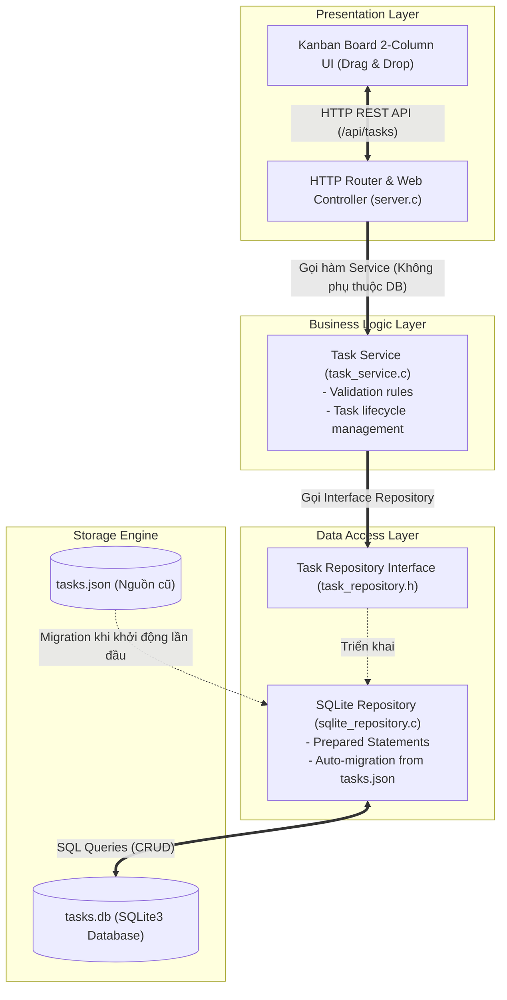

# CNPM Tuần 7: Tiến hóa kiến trúc ứng dụng quản lý công việc

Dự án cài đặt ứng dụng quản lý công việc (Task Management) tiến hóa qua các phiên bản kiến trúc theo yêu cầu môn **Công nghệ phần mềm** (Software Architecture Evolution).

---

## 📌 Tổng quan các phiên bản

| Phiên bản | Mô hình kiến trúc | Phạm vi triển khai & Lưu trữ | Trạng thái |
| :--- | :--- | :--- | :--- |
| **V1** | Standalone Local Process | Chạy cục bộ 1 máy, file `tasks.json` | ✅ Hoàn thành (`tag: v1.0`) |
| **V2** | Client–Server (Centralized State) | Nhiều client kết nối chung 1 C server qua LAN / Ngrok Tunnel | ✅ Hoàn thành (`tag: v2.0`) |
| **V3** | **N-Layer & Kanban Board** | **Tách 3 tầng (Presentation / Service / Repository), Database SQLite3** | ✅ **Hoàn thành (`tag: v3.0`)** |
| **V4** | Peer-to-Peer (P2P Direct Sync) | Đồng bộ ngang hàng khi mất server trung tâm | ⏳ Tiếp theo |

---

## 🌐 Đường link truy cập ứng dụng

- **Truy cập cục bộ:** [http://localhost:8080](http://localhost:8080)
- **Truy cập công khai đa thiết bị qua Internet (Ngrok Tunnel):**  
  👉 **[https://kiera-keratometric-varietally.ngrok-free.dev](https://kiera-keratometric-varietally.ngrok-free.dev)**
- **Kiểm tra thông số kiến trúc API:** `GET /api/info`

---

## 🚀 Hướng dẫn khởi chạy & Kiểm chứng

### 1. Khởi chạy C Backend & Ngrok Tunnel
```bash
./start_ngrok.sh
```

### 2. Kiểm chứng tự động từng phiên bản
```bash
# Kiểm chứng Version 1 (Persistence trên tasks.json)
./test_v1.sh

# Kiểm chứng Version 2 (Client A và Client B đa thiết bị)
./test_v2.sh

# Kiểm chứng Version 3 (N-Layer, SQLite Migration & Kanban)
./test_v3.sh
```

---

## 🏛️ Chi tiết kiến trúc Version 3: N-Layer & Thay đổi Nguồn lưu trữ / UI

### 1. Yêu cầu & Ràng buộc theo đề bài
- **Yêu cầu từ khách hàng:**
  1. Giao diện danh sách cũ phải thay bằng **bảng Kanban hai cột: Chưa hoàn thành và Hoàn thành**.
  2. Thay cách lưu trữ từ **tệp JSON sang cơ sở dữ liệu SQLite** (`tasks.db`).
  3. **Không được mất các task cũ** (Dữ liệu từ V1 và V2 được tự động chuyển đổi sang SQLite).
- **Thuộc tính chất lượng (NFR):**
  - **Modifiability (Khả năng thay đổi):** Dễ dàng thay thế giao diện người dùng (Presentation) và nguồn lưu trữ (Persistence) mà nghiệp vụ cốt lõi không bị xáo trộn hoặc phụ thuộc lẫn nhau.
  - **Separation of Concerns (Tách biệt mối quan tâm):** Áp dụng mô hình **N-Layer** phân rã ứng dụng thành các lớp chuyên biệt.

---

### 2. Phân chia các tầng kiến trúc N-Layer trong mã nguồn

```text
                  +----------------------------------------------+
                  |              PRESENTATION LAYER              |
                  |  - Web UI: Kanban Board (HTML5, CSS, JS)     |
                  |  - HTTP Controller & Router: server.c        |
                  +----------------------------------------------+
                                         |
                                         v
                  +----------------------------------------------+
                  |             BUSINESS LOGIC LAYER             |
                  |  - Task Service: task_service.h / .c         |
                  |  - Task Validation & Business Rules          |
                  +----------------------------------------------+
                                         |
                                         v
                  +----------------------------------------------+
                  |              DATA ACCESS LAYER               |
                  |  - Repository Interface: task_repository.h   |
                  |  - SQLite Implementation: sqlite_repository.c|
                  |  - Migration Logic (tasks.json -> tasks.db)  |
                  +----------------------------------------------+
                                         |
                                         v
                  +----------------------------------------------+
                  |               DATABASE ENGINE                |
                  |  - SQLite 3 (tasks.db) with WAL mode         |
                  +----------------------------------------------+
```

#### 🔹 Tầng 1: Presentation Layer (Giao diện & Điều khiển HTTP)
- **Mã nguồn:** [server.c](file:///home/cheems/Projects/CNPM-W7-TODO/server.c), [public/index.html](file:///home/cheems/Projects/CNPM-W7-TODO/public/index.html), [public/style.css](file:///home/cheems/Projects/CNPM-W7-TODO/public/style.css), [public/app.js](file:///home/cheems/Projects/CNPM-W7-TODO/public/app.js)
- **Trách nhiệm:** 
  - Lắng nghe HTTP request, định tuyến URL (`/api/tasks`, `/api/info`), kiểm tra định dạng HTTP body và trả về mã trạng thái HTTP (200, 201, 400, 404).
  - Phục vụ bảng **Kanban 2 cột**: Cột *Chưa hoàn thành* và Cột *Đã hoàn thành*. Hỗ trợ tương tác kéo-thả (Drag & Drop) và nút chuyển nhanh 1-chạm giữa 2 cột.
  - **Độc lập:** Tầng này không chứa câu lệnh SQL nào và không truy cập trực tiếp file database.

#### 🔹 Tầng 2: Business Logic Layer (Dịch vụ Nghiệp vụ)
- **Mã nguồn:** [task_service.h](file:///home/cheems/Projects/CNPM-W7-TODO/task_service.h), [task_service.c](file:///home/cheems/Projects/CNPM-W7-TODO/task_service.c)
- **Trách nhiệm:**
  - Thực thi quy tắc nghiệp vụ: Xác thực tính hợp lệ của tiêu đề task (không được rỗng, không chứa khoảng trắng đơn thuần, giới hạn độ dài), kiểm tra tính hợp lệ của ID.
  - Đóng vai trò trung gian phối hợp giữa Controller và Repository.
  - **Độc lập:** Hoàn toàn **không biết** về giao diện Kanban, cũng **không biết** cơ sở dữ liệu là SQLite hay JSON. Nếu thay thế giao diện (từ Kanban sang Calendar hay Gantt chart), tầng nghiệp vụ hoàn toàn giữ nguyên.

#### 🔹 Tầng 3: Data Access Layer (Truy xuất Dữ liệu)
- **Mã nguồn:** [task_repository.h](file:///home/cheems/Projects/CNPM-W7-TODO/task_repository.h), [sqlite_repository.c](file:///home/cheems/Projects/CNPM-W7-TODO/sqlite_repository.c)
- **Trách nhiệm:**
  - Định nghĩa interface trừu tượng `task_repository.h` (`repo_get_all_tasks`, `repo_create_task`, `repo_update_task`, `repo_delete_task`).
  - Hiện thực bằng thư viện SQLite3 (`sqlite_repository.c`): Khởi tạo bảng `tasks`, bật chế độ ghi nhật ký `WAL (Write-Ahead Logging)` giúp tối ưu truy cập đồng thời, thực thi các câu lệnh SQL chuẩn hóa.
  - **Cơ chế Migration tự động:** Khi khởi động, nếu bảng `tasks` trong SQLite còn trống và tệp `tasks.json` cũ tồn tại, hệ thống tự động đọc và insert toàn bộ task cũ vào SQLite, giữ nguyên toàn bộ ID, trạng thái và mốc thời gian.

---

### 3. Minh chứng tách biệt: Các file thay đổi ở Version 3

Theo yêu cầu đề bài: *"Chỉ rõ những file thay đổi khi đổi UI và khi đổi database"*:

| Thao tác tiến hóa | Các file thay đổi / tạo mới | Giải thích kiến trúc |
| :--- | :--- | :--- |
| **Đổi UI (Danh sách cũ &rarr; Bảng Kanban 2 cột)** | - [public/index.html](file:///home/cheems/Projects/CNPM-W7-TODO/public/index.html)<br>- [public/style.css](file:///home/cheems/Projects/CNPM-W7-TODO/public/style.css)<br>- [public/app.js](file:///home/cheems/Projects/CNPM-W7-TODO/public/app.js) | Chỉ thay đổi phần Presentation (HTML cấu trúc 2 cột, CSS Kanban dropzone và JS Drag & Drop). **Tầng Service và Repository không thay đổi một dòng code nào.** |
| **Đổi Database (File JSON &rarr; SQLite3 Database)** | - [task_repository.h](file:///home/cheems/Projects/CNPM-W7-TODO/task_repository.h)<br>- [sqlite_repository.c](file:///home/cheems/Projects/CNPM-W7-TODO/sqlite_repository.c)<br>- [Makefile](file:///home/cheems/Projects/CNPM-W7-TODO/Makefile) (thêm `-lsqlite3`) | Toàn bộ truy xuất SQL và logic migration được đóng gói bên trong tầng Data Access. Giao diện Web bên ngoài và các endpoint API `/api/tasks` giữ nguyên hợp đồng giao tiếp (API Contract). |

---

## 📊 Nhật ký quyết định kiến trúc (Mẫu Mục 04)

| Version | NFR mới | Quyết định thiết kế | File/thành phần đổi | Kết quả test |
| :--- | :--- | :--- | :--- | :--- |
| **V1** | **Data Persistence** trên một máy cục bộ (Dữ liệu không mất khi restart). | Xây dựng Single-Process C Backend với POSIX Sockets phục vụ REST API + Static Files; đọc/ghi dữ liệu vào `tasks.json` an toàn bằng `cJSON` và atomic rename. | `server.c`, `cJSON.c`, `cJSON.h`, `Makefile`, `public/index.html`, `public/style.css`, `public/app.js`, `tasks.json`. | Đạt: Tạo 2 task, cập nhật 1 task, tắt và khởi động lại server dữ liệu được khôi phục 100%. |
| **V2** | **Centralized Shared State** giữa nhiều client đồng thời qua mạng; tính tươi mới (Freshness). | Cấu hình C Server bind `0.0.0.0`, mở rộng CORS; chuyển tiếp port qua **Ngrok Tunnel** ra Internet; bổ sung cơ chế **Auto-Polling (2.5s)** trên Frontend để đồng bộ hai chiều giữa các client. | `server.c`, `public/index.html`, `public/style.css`, `public/app.js`, `start_ngrok.sh`, `test_v2.sh`. | Đạt: Client A tạo task, Client B thấy sau 2.5s; Client B hoàn thành task, Client A thấy ngay trạng thái mới. |
| **V3** | **Modifiability** & **Separation of Concerns** (Tách Presentation, Business Logic, Data Access; hỗ trợ ACID database). | Áp dụng mô hình **N-Layer**: Tách `task_service` (nghiệp vụ) và `sqlite_repository` (Data Access SQLite3); chuyển đổi giao diện sang **Kanban 2 cột** (Drag & Drop); tự động migrate dữ liệu từ `tasks.json` sang `tasks.db`. | `task_repository.h`, `sqlite_repository.c`, `task_service.h`, `task_service.c`, `server.c`, `Makefile`, `public/index.html`, `public/style.css`, `public/app.js`, `test_v3.sh`. | Đạt: Toàn bộ task cũ từ V2 được chuyển sang SQLite không mất mát; kéo thả chuyển cột Kanban mượt mà; tắt mở lại server dữ liệu SQLite toàn vẹn. |

---

## 📐 Sơ đồ kiến trúc Version 3 (N-Layer & SQLite)



---

## 💡 Trả lời câu hỏi thảo luận mục 03 & 05 (V3)

> **Câu hỏi 1:** *Đổi SQLite sang một nguồn lưu trữ khác sẽ ảnh hưởng file nào?*
- **Trả lời:** Chỉ ảnh hưởng duy nhất file cài đặt Repository trong tầng Data Access (ví dụ viết file mới `postgres_repository.c` hoặc `mysql_repository.c` kế thừa `task_repository.h`) và file `Makefile` (thêm thư viện liên kết).  
- Tầng nghiệp vụ (`task_service.c`), bộ điều khiển HTTP (`server.c`) và toàn bộ mã nguồn giao diện Web (`public/`) hoàn toàn **không cần thay đổi một dòng nào**.

> **Câu hỏi 2:** *Tầng nghiệp vụ có cần biết giao diện Kanban không?*
- **Trả lời:** **Hoàn toàn không**. Tầng nghiệp vụ (`task_service`) chỉ quan tâm đến các thuộc tính thực thể của công việc (`id`, `title`, `completed`, `created_at`) và các quy tắc xác thực (tiêu đề hợp lệ, ID hợp lệ). Việc dữ liệu được hiển thị dưới dạng danh sách thông thường, bảng Kanban 2 cột, hay sơ đồ phân cấp là trách nhiệm độc quyền của tầng Presentation.

> **Câu hỏi 3:** *Có bằng chứng tách biệt giữa thay đổi UI và thay đổi Database không?*
- **Trả lời:** Có. Bằng chứng rõ ràng qua lịch sử commit:
  - Khi thay đổi UI sang bảng Kanban, chỉ các tệp trong thư mục [public/](file:///home/cheems/Projects/CNPM-W7-TODO/public) thay đổi. Backend hoàn toàn giữ nguyên contract API REST.
  - Khi thay đổi lưu trữ từ JSON sang SQLite, chúng tôi chỉ tạo mới [sqlite_repository.c](file:///home/cheems/Projects/CNPM-W7-TODO/sqlite_repository.c) và [task_repository.h](file:///home/cheems/Projects/CNPM-W7-TODO/task_repository.h). Giao diện Kanban không cần biết câu truy vấn SQL bên dưới là gì.