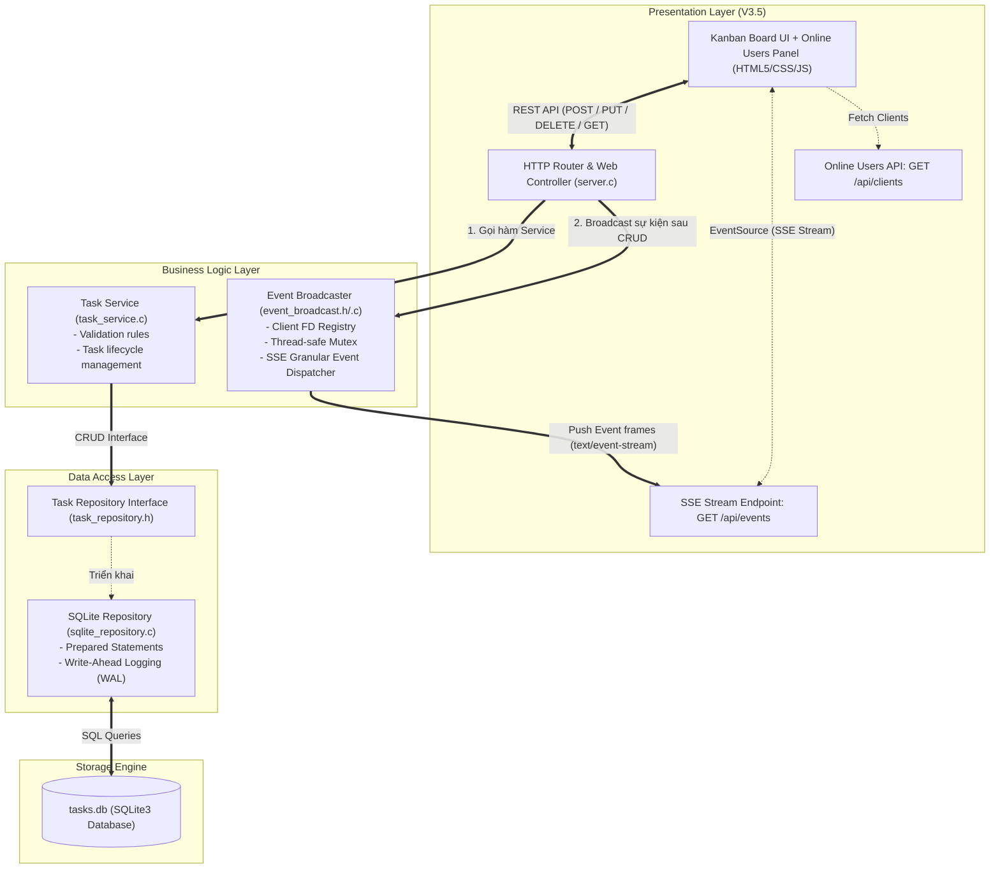
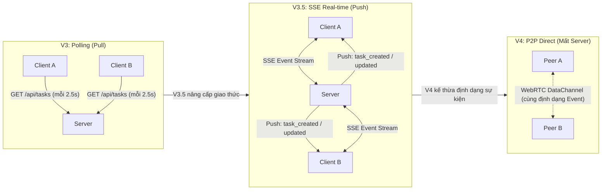

# CNPM Tuần 7: Tiến hóa kiến trúc ứng dụng quản lý công việc

Dự án cài đặt ứng dụng quản lý công việc (Task Management) tiến hóa qua các phiên bản kiến trúc theo yêu cầu môn **Công nghệ phần mềm** (Software Architecture Evolution).

---

## 📌 Tổng quan các phiên bản

| Phiên bản | Mô hình kiến trúc | Phạm vi triển khai & Lưu trữ | Trạng thái |
| :--- | :--- | :--- | :--- |
| **V1** | Standalone Local Process | Chạy cục bộ 1 máy, file `tasks.json` | ✅ Hoàn thành (`tag: v1.0`) |
| **V2** | Client–Server (Centralized State) | Nhiều client kết nối chung 1 C server qua LAN / Ngrok Tunnel | ✅ Hoàn thành (`tag: v2.0`) |
| **V3** | N-Layer & Kanban Board | Tách 3 tầng (Presentation / Service / Repository), Database SQLite3 | ✅ Hoàn thành (`tag: v3.0`) |
| **V3.5** | **N-Layer + SSE Real-time Collaboration** | **Thay HTTP Polling bằng Server-Sent Events; nhận biết người dùng online** | ✅ **Hoàn thành (`tag: v3.5`)** |
| **V4** | **Peer-to-Peer (P2P Direct Collaboration)** | **WebRTC DataChannel: Đồng bộ ngang hàng trực tiếp khi mất server trung tâm** | ✅ **Hoàn thành (`tag: v4.0`)** |

---

## 🌐 Đường link truy cập ứng dụng

- **Truy cập cục bộ:** [http://localhost:8080](http://localhost:8080)
- **Truy cập công khai đa thiết bị qua Internet (Ngrok Tunnel):**  
  👉 **[https://kiera-keratometric-varietally.ngrok-free.dev](https://kiera-keratometric-varietally.ngrok-free.dev)**
- **Kiểm tra thông số kiến trúc API:** `GET /api/info`

---

## 🚀 Hướng dẫn khởi chạy & Kiểm chứng

### 1. Khởi chạy C Backend & Ngrok Tunnel
```bash
./start_ngrok.sh
```

### 2. Kiểm chứng tự động từng phiên bản
```bash
# Kiểm chứng Version 1 (Persistence trên tasks.json)
./test_v1.sh

# Kiểm chứng Version 2 (Client A và Client B đa thiết bị)
./test_v2.sh

# Kiểm chứng Version 3 (N-Layer, SQLite Migration & Kanban)
./test_v3.sh

# Kiểm chứng Version 3.5 (SSE Real-time, Online Users)
./test_v3_5.sh

# Kiểm chứng Version 4 (P2P WebRTC DataChannel, Lamport Clock, Offline Fallback)
./test_v4.sh
```

---

## 🏛️ Chi tiết kiến trúc Version 3: N-Layer & Thay đổi Nguồn lưu trữ / UI

### 1. Yêu cầu & Ràng buộc theo đề bài
- **Yêu cầu từ khách hàng:**
  1. Giao diện danh sách cũ phải thay bằng **bảng Kanban hai cột: Chưa hoàn thành và Hoàn thành**.
  2. Thay cách lưu trữ từ **tệp JSON sang cơ sở dữ liệu SQLite** (`tasks.db`).
  3. **Không được mất các task cũ** (Dữ liệu từ V1 và V2 được tự động chuyển đổi sang SQLite).
- **Thuộc tính chất lượng (NFR):**
  - **Modifiability (Khả năng thay đổi):** Dễ dàng thay thế giao diện người dùng (Presentation) và nguồn lưu trữ (Persistence) mà nghiệp vụ cốt lõi không bị xáo trộn hoặc phụ thuộc lẫn nhau.
  - **Separation of Concerns (Tách biệt mối quan tâm):** Áp dụng mô hình **N-Layer** phân rã ứng dụng thành các lớp chuyên biệt.

---

### 2. Phân chia các tầng kiến trúc N-Layer trong mã nguồn

```text
                  +----------------------------------------------+
                  |              PRESENTATION LAYER              |
                  |  - Web UI: Kanban Board (HTML5, CSS, JS)     |
                  |  - HTTP Controller & Router: server.c        |
                  +----------------------------------------------+
                                         |
                                         v
                  +----------------------------------------------+
                  |             BUSINESS LOGIC LAYER             |
                  |  - Task Service: task_service.h / .c         |
                  |  - Task Validation & Business Rules          |
                  +----------------------------------------------+
                                         |
                                         v
                  +----------------------------------------------+
                  |              DATA ACCESS LAYER               |
                  |  - Repository Interface: task_repository.h   |
                  |  - SQLite Implementation: sqlite_repository.c|
                  |  - Migration Logic (tasks.json -> tasks.db)  |
                  +----------------------------------------------+
                                         |
                                         v
                  +----------------------------------------------+
                  |               DATABASE ENGINE                |
                  |  - SQLite 3 (tasks.db) with WAL mode         |
                  +----------------------------------------------+
```

#### 🔹 Tầng 1: Presentation Layer (Giao diện & Điều khiển HTTP)
- **Mã nguồn:** [server.c](file:///home/cheems/Projects/CNPM-W7-TODO/server.c), [public/index.html](file:///home/cheems/Projects/CNPM-W7-TODO/public/index.html), [public/style.css](file:///home/cheems/Projects/CNPM-W7-TODO/public/style.css), [public/app.js](file:///home/cheems/Projects/CNPM-W7-TODO/public/app.js)
- **Trách nhiệm:** 
  - Lắng nghe HTTP request, định tuyến URL (`/api/tasks`, `/api/info`), kiểm tra định dạng HTTP body và trả về mã trạng thái HTTP (200, 201, 400, 404).
  - Phục vụ bảng **Kanban 2 cột**: Cột *Chưa hoàn thành* và Cột *Đã hoàn thành*. Hỗ trợ tương tác kéo-thả (Drag & Drop) và nút chuyển nhanh 1-chạm giữa 2 cột.
  - **Độc lập:** Tầng này không chứa câu lệnh SQL nào và không truy cập trực tiếp file database.

#### 🔹 Tầng 2: Business Logic Layer (Dịch vụ Nghiệp vụ)
- **Mã nguồn:** [task_service.h](file:///home/cheems/Projects/CNPM-W7-TODO/task_service.h), [task_service.c](file:///home/cheems/Projects/CNPM-W7-TODO/task_service.c)
- **Trách nhiệm:**
  - Thực thi quy tắc nghiệp vụ: Xác thực tính hợp lệ của tiêu đề task (không được rỗng, không chứa khoảng trắng đơn thuần, giới hạn độ dài), kiểm tra tính hợp lệ của ID.
  - Đóng vai trò trung gian phối hợp giữa Controller và Repository.
  - **Độc lập:** Hoàn toàn **không biết** về giao diện Kanban, cũng **không biết** cơ sở dữ liệu là SQLite hay JSON. Nếu thay thế giao diện (từ Kanban sang Calendar hay Gantt chart), tầng nghiệp vụ hoàn toàn giữ nguyên.

#### 🔹 Tầng 3: Data Access Layer (Truy xuất Dữ liệu)
- **Mã nguồn:** [task_repository.h](file:///home/cheems/Projects/CNPM-W7-TODO/task_repository.h), [sqlite_repository.c](file:///home/cheems/Projects/CNPM-W7-TODO/sqlite_repository.c)
- **Trách nhiệm:**
  - Định nghĩa interface trừu tượng `task_repository.h` (`repo_get_all_tasks`, `repo_create_task`, `repo_update_task`, `repo_delete_task`).
  - Hiện thực bằng thư viện SQLite3 (`sqlite_repository.c`): Khởi tạo bảng `tasks`, bật chế độ ghi nhật ký `WAL (Write-Ahead Logging)` giúp tối ưu truy cập đồng thời, thực thi các câu lệnh SQL chuẩn hóa.
  - **Cơ chế Migration tự động:** Khi khởi động, nếu bảng `tasks` trong SQLite còn trống và tệp `tasks.json` cũ tồn tại, hệ thống tự động đọc và insert toàn bộ task cũ vào SQLite, giữ nguyên toàn bộ ID, trạng thái và mốc thời gian.

---

### 3. Minh chứng tách biệt: Các file thay đổi ở Version 3

Theo yêu cầu đề bài: *"Chỉ rõ những file thay đổi khi đổi UI và khi đổi database"*:

| Thao tác tiến hóa | Các file thay đổi / tạo mới | Giải thích kiến trúc |
| :--- | :--- | :--- |
| **Đổi UI (Danh sách cũ &rarr; Bảng Kanban 2 cột)** | - [public/index.html](file:///home/cheems/Projects/CNPM-W7-TODO/public/index.html)<br>- [public/style.css](file:///home/cheems/Projects/CNPM-W7-TODO/public/style.css)<br>- [public/app.js](file:///home/cheems/Projects/CNPM-W7-TODO/public/app.js) | Chỉ thay đổi phần Presentation (HTML cấu trúc 2 cột, CSS Kanban dropzone và JS Drag & Drop). **Tầng Service và Repository không thay đổi một dòng code nào.** |
| **Đổi Database (File JSON &rarr; SQLite3 Database)** | - [task_repository.h](file:///home/cheems/Projects/CNPM-W7-TODO/task_repository.h)<br>- [sqlite_repository.c](file:///home/cheems/Projects/CNPM-W7-TODO/sqlite_repository.c)<br>- [Makefile](file:///home/cheems/Projects/CNPM-W7-TODO/Makefile) (thêm `-lsqlite3`) | Toàn bộ truy xuất SQL và logic migration được đóng gói bên trong tầng Data Access. Giao diện Web bên ngoài và các endpoint API `/api/tasks` giữ nguyên hợp đồng giao tiếp (API Contract). |

---

## 📊 Nhật ký quyết định kiến trúc (Mẫu Mục 04)

| Version | NFR mới | Quyết định thiết kế | File/thành phần đổi | Kết quả test |
| :--- | :--- | :--- | :--- | :--- |
| **V1** | **Data Persistence** trên một máy cục bộ (Dữ liệu không mất khi restart). | Xây dựng Single-Process C Backend với POSIX Sockets phục vụ REST API + Static Files; đọc/ghi dữ liệu vào `tasks.json` an toàn bằng `cJSON` và atomic rename. | `server.c`, `cJSON.c`, `cJSON.h`, `Makefile`, `public/index.html`, `public/style.css`, `public/app.js`, `tasks.json`. | Đạt: Tạo 2 task, cập nhật 1 task, tắt và khởi động lại server dữ liệu được khôi phục 100%. |
| **V2** | **Centralized Shared State** giữa nhiều client đồng thời qua mạng; tính tươi mới (Freshness). | Cấu hình C Server bind `0.0.0.0`, mở rộng CORS; chuyển tiếp port qua **Ngrok Tunnel** ra Internet; bổ sung cơ chế **Auto-Polling (2.5s)** trên Frontend để đồng bộ hai chiều giữa các client. | `server.c`, `public/index.html`, `public/style.css`, `public/app.js`, `start_ngrok.sh`, `test_v2.sh`. | Đạt: Client A tạo task, Client B thấy sau 2.5s; Client B hoàn thành task, Client A thấy ngay trạng thái mới. |
| **V3** | **Modifiability** & **Separation of Concerns** (Tách Presentation, Business Logic, Data Access; hỗ trợ ACID database). | Áp dụng mô hình **N-Layer**: Tách `task_service` (nghiệp vụ) và `sqlite_repository` (Data Access SQLite3); chuyển đổi giao diện sang **Kanban 2 cột** (Drag & Drop); tự động migrate dữ liệu từ `tasks.json` sang `tasks.db`. | `task_repository.h`, `sqlite_repository.c`, `task_service.h`, `task_service.c`, `server.c`, `Makefile`, `public/index.html`, `public/style.css`, `public/app.js`, `test_v3.sh`. | Đạt: Toàn bộ task cũ từ V2 được chuyển sang SQLite không mất mát; kéo thả chuyển cột Kanban mượt mà; tắt mở lại server dữ liệu SQLite toàn vẹn. |
| **V3.5** | **Real-time Collaboration & Multi-User Awareness** (Cộng tác thời gian thực tức thì <50ms; giảm tải băng thông mạng; nhận biết người dùng online; tiền đề event stream cho P2P V4). | Thay thế HTTP Polling bằng **Server-Sent Events (SSE)** tại `GET /api/events` và `GET /api/clients`; xây dựng module `event_broadcast.c/.h` đa luồng (`pthread_mutex_t`) quản lý kết nối client và broadcast các sự kiện granular (`task_created`, `task_updated`, `task_deleted`, `client_joined`, `client_left`); Frontend cập nhật DOM trực tiếp theo event (không cần load lại toàn bộ danh sách); hỗ trợ tự động fallback sang polling nếu mất kết nối SSE. | `event_broadcast.h`, `event_broadcast.c`, `server.c`, `Makefile`, `public/app.js`, `public/index.html`, `public/style.css`, `test_v3_5.sh`. | Đạt: 11/11 bài test tự động (`test_v3_5.sh`). Client A thêm/sửa/xóa task thì Client B nhận event SSE tức thì; nhận biết chính xác số người dùng online; kiểm tra hồi quy V1, V2, V3 đều vượt qua 100%. |
| **V4** | **High Availability & Decentralized Fault Tolerance** (Vận hành không gián đoạn khi server trung tâm sập; chia sẻ và đồng bộ trực tiếp giữa 2 thiết bị trong LAN). | Bổ sung đường truyền P2P qua **WebRTC DataChannel** (`RTCPeerConnection`); hỗ trợ 2 chế độ: **1-Click Local Tab Sync** (qua `BroadcastChannel` cho 2 tab thử nghiệm) và **Manual SDP Token Exchange** (cho 2 máy LAN độc lập không cần server); tái sử dụng Granular Event Protocol từ V3.5; bổ sung cơ chế **Last-Write-Wins (LWW) kết hợp Lamport Logical Timestamp** để hòa giải xung đột dữ liệu; tự động chuyển tiếp CRUD sang DataChannel khi phát hiện server offline. | `public/app.js`, `public/index.html`, `public/style.css`, `server.c` (`/api/info`), `test_v4.sh`, `README.md`. | Đạt: 10/10 bài test tự động (`test_v4.sh`). Kết nối P2P giữa hai client; tắt hoàn toàn C backend server (`kill -9`); Client A tạo task &rarr; Client B nhận được ngay; Client B đổi trạng thái &rarr; Client A nhận được ngay khi server đã chết 100%. |

---

## 📐 Sơ đồ kiến trúc Version 3.5 (N-Layer + SSE Real-time Broadcast)



---

## ⚡ Chi tiết kiến trúc Version 3.5: Cộng tác đa người dùng thời gian thực

### 1. Vấn đề nảy sinh và Động lực kiến trúc của Version 3.5
- **Hạn chế của Polling ở Version 2 & Version 3:**
  - Ở V2 và V3, các client đồng bộ dữ liệu bằng cơ chế **HTTP Polling định kỳ mỗi 2.5 giây** (`setInterval`).
  - Mỗi 2.5s, mọi client gửi `GET /api/tasks` kéo **toàn bộ mảng JSON** về máy, bất kể có dữ liệu mới hay không. Điều này gây lãng phí băng thông mạng, tăng tải CPU cho server khi số lượng client tăng.
  - Độ trễ phản hồi (latency) trung bình lên đến 1.25s - 2.5s, không mang lại trải nghiệm cộng tác tức thời (real-time).
  - Không có thông tin trạng thái người dùng (không biết ai đang cùng làm việc trên bảng công việc).
- **Mục tiêu của Version 3.5:**
  1. Chuyển sang mô hình **Push (Server-Sent Events)**: Server chủ động đẩy thông báo ngay khi có sự thay đổi. Độ trễ giảm xuống dưới 50ms.
  2. **Giao thức sự kiện rời rạc (Granular Event Protocol)**: Thay vì tải lại toàn bộ danh sách, server chỉ gửi một gói tin sự kiện nhỏ (`task_created`, `task_updated`, `task_deleted`) kèm dữ liệu task tương ứng. Client tự cập nhật DOM tương ứng.
  3. **Nhận biết cộng tác viên (Multi-User Awareness)**: Hiển thị số lượng và danh sách người dùng đang online trên giao diện.
  4. **Tiền đề kiến trúc cho Version 4 (P2P Direct Sync)**: Định dạng sự kiện JSON được thiết kế chuẩn hóa để khi chuyển sang Version 4 (P2P qua WebRTC DataChannel khi mất server), logic xử lý sự kiện ở client hoàn toàn được tái sử dụng mà không cần viết lại.

### 2. So sánh kiến trúc V3 (Polling) vs V3.5 (SSE) vs V4 (P2P Tiền đề)



### 3. Minh chứng tách biệt: Các file thay đổi ở Version 3.5

| Thao tác | File | Trách nhiệm kiến trúc |
| :--- | :--- | :--- |
| **[TẠO MỚI]** | [event_broadcast.h](file:///home/cheems/Projects/CNPM-W7-TODO/event_broadcast.h) | Interface định nghĩa các loại sự kiện (`event_type_t`) và API quản lý SSE clients. |
| **[TẠO MỚI]** | [event_broadcast.c](file:///home/cheems/Projects/CNPM-W7-TODO/event_broadcast.c) | Cài đặt lưu trữ mảng file descriptor của client, bảo vệ tương tranh bằng `pthread_mutex_t`, phát hiện client disconnect và broadcast gói tin `text/event-stream`. |
| **[TẠO MỚI]** | [test_v3_5.sh](file:///home/cheems/Projects/CNPM-W7-TODO/test_v3_5.sh) | Script kiểm chứng tự động 11 kịch bản: SSE streaming, multi-client broadcast, CRUD event dispatch, online awareness. |
| **[CHỈNH SỬA]** | [server.c](file:///home/cheems/Projects/CNPM-W7-TODO/server.c) | Thêm route `GET /api/events` (giữ connection mở phục vụ SSE) và `GET /api/clients`; gọi `broadcast_event()` sau mỗi thao tác tạo/sửa/xóa thành công. |
| **[CHỈNH SỬA]** | [Makefile](file:///home/cheems/Projects/CNPM-W7-TODO/Makefile) | Thêm `event_broadcast.c` vào danh sách biên dịch backend. |
| **[CHỈNH SỬA]** | [public/app.js](file:///home/cheems/Projects/CNPM-W7-TODO/public/app.js) | Kết nối `EventSource`, lắng nghe 5 loại sự kiện SSE để patch state cục bộ tức thì; cơ chế tự động fallback về polling khi mất kết nối. |
| **[CHỈNH SỬA]** | [public/index.html](file:///home/cheems/Projects/CNPM-W7-TODO/public/index.html) | Bổ sung widget "Online Users Panel", cập nhật phiên bản hiển thị Version 3.5. |
| **[CHỈNH SỬA]** | [public/style.css](file:///home/cheems/Projects/CNPM-W7-TODO/public/style.css) | Styles hiệu ứng đèn xanh nhấp nháy (pulse), avatar chip cho danh sách người dùng đang online. |
| **[GIỮ NGUYÊN 100%]** | [task_service.c](file:///home/cheems/Projects/CNPM-W7-TODO/task_service.c) | **Tầng Business Logic hoàn toàn không bị ảnh hưởng.** Quy tắc nghiệp vụ và xác thực công việc giữ nguyên. |
| **[GIỮ NGUYÊN 100%]** | [sqlite_repository.c](file:///home/cheems/Projects/CNPM-W7-TODO/sqlite_repository.c) | **Tầng Data Access hoàn toàn không bị ảnh hưởng.** Cấu trúc bảng SQLite và các hàm thao tác database giữ nguyên. |

---

## 💡 Trả lời câu hỏi thảo luận kiến trúc (V3 & V3.5)

> **Câu hỏi 1:** *Đổi SQLite sang một nguồn lưu trữ khác sẽ ảnh hưởng file nào?*
- **Trả lời:** Chỉ ảnh hưởng duy nhất file cài đặt Repository trong tầng Data Access (ví dụ viết file mới `postgres_repository.c` hoặc `mysql_repository.c` kế thừa `task_repository.h`) và file `Makefile` (thêm thư viện liên kết).  
- Tầng nghiệp vụ (`task_service.c`), bộ điều khiển HTTP (`server.c`) và toàn bộ mã nguồn giao diện Web (`public/`) hoàn toàn **không cần thay đổi một dòng nào**.

> **Câu hỏi 2:** *Tầng nghiệp vụ có cần biết giao diện Kanban hoặc cơ chế SSE không?*
- **Trả lời:** **Hoàn toàn không**. Tầng nghiệp vụ (`task_service`) chỉ quan tâm đến các thuộc tính thực thể của công việc (`id`, `title`, `completed`, `created_at`) và các quy tắc xác thực (tiêu đề hợp lệ, ID hợp lệ). Việc dữ liệu hiển thị dạng danh sách hay Kanban, hoặc được đẩy qua SSE hay REST Polling là trách nhiệm riêng của tầng Presentation/Communication.

> **Câu hỏi 3:** *Có bằng chứng tách biệt giữa thay đổi UI, thay đổi Database và thay đổi cơ chế giao tiếp Real-time không?*
- **Trả lời:** Có. Bằng chứng rõ ràng qua lịch sử commit:
  - Khi thay đổi UI sang bảng Kanban (V3), chỉ các tệp trong thư mục [public/](file:///home/cheems/Projects/CNPM-W7-TODO/public) thay đổi.
  - Khi thay đổi lưu trữ từ JSON sang SQLite (V3), chỉ tạo mới [sqlite_repository.c](file:///home/cheems/Projects/CNPM-W7-TODO/sqlite_repository.c) và [task_repository.h](file:///home/cheems/Projects/CNPM-W7-TODO/task_repository.h).
  - Khi nâng cấp lên Real-time SSE (V3.5), tầng Business Logic (`task_service.c`) và tầng Data Access (`sqlite_repository.c`) được giữ nguyên 100%.

> **Câu hỏi 4:** *Version 3.5 đóng vai trò gì làm tiền đề cho Version 4 (P2P khi mất server)?*
- **Trả lời:** Version 3.5 chuẩn hóa **Event Protocol** (`task_created`, `task_updated`, `task_deleted`) với payload JSON đồng nhất. Trong Version 4, khi server trung tâm mất kết nối, hai máy trong cùng mạng LAN chỉ cần hoán đổi tầng truyền tải từ **SSE (Server Push)** sang **WebRTC DataChannel (Peer-to-Peer Direct)**. Tầng xử lý sự kiện và cập nhật giao diện Kanban ở client giữ nguyên hoàn toàn logic đã được kiểm chứng ở V3.5.

---

## 🛰️ Chi tiết kiến trúc Version 4: Cộng tác P2P khi mất kết nối Server

### 1. Bối cảnh và Thuộc tính chất lượng (NFR)
- **Yêu cầu từ khách hàng:** Hai thành viên đang cùng mạng LAN nhưng server trung tâm không truy cập được (sập nguồn, lỗi mạng, hoặc bảo trì). Họ cần tiếp tục chia sẻ task mới và thay đổi trạng thái trực tiếp giữa hai thiết bị mà không dùng server trung gian.
- **Thuộc tính chất lượng cần xem xét:**
  - **Availability (Tính sẵn sàng cao):** Hệ thống không phụ thuộc vào một điểm lỗi duy nhất (Single Point of Failure - SPOF). Người dùng tiếp tục thao tác không bị chặn.
  - **Decentralized Fault Tolerance (Khả năng chịu lỗi phân tán):** Kênh truyền ngang hàng trực tiếp (P2P) tiếp nhận các thao tác CRUD và đồng bộ tức thời giữa hai máy.
- **Lưu ý kiến trúc:** Client–Server, N-Layer và P2P cùng tồn tại trong hệ thống. Khi server online, ứng dụng hoạt động theo mô hình Client–Server chuẩn với SQLite và SSE. Khi server offline, ứng dụng tự động chuyển tiếp qua kênh WebRTC DataChannel mà không phá vỡ cấu trúc N-Layer.

---

### 2. Sơ đồ luồng kết nối Version 4 (Mermaid)

```mermaid
sequenceDiagram
    autonumber
    actor Alice as Peer A (Client A)
    actor Bob as Peer B (Client B)
    participant Server as C Central Server (tasks.db)
    participant P2P as WebRTC DataChannel (Direct P2P)

    rect rgb(240, 248, 255)
        note over Alice, Server: Giai đoạn 1: Hoạt động bình thường (V3 / V3.5)
        Alice->>Server: REST API / SSE (Đọc & Ghi task vào SQLite)
        Bob->>Server: REST API / SSE (Đọc & Ghi task vào SQLite)
        Server-->>Alice: Push real-time event qua SSE
        Server-->>Bob: Push real-time event qua SSE
    end

    rect rgb(255, 250, 240)
        note over Alice, Bob: Giai đoạn 2: Thiết lập kênh truyền WebRTC DataChannel (P2P)
        Alice->>Bob: Trao đổi SDP Offer / ICE Candidates (1-Click BroadcastChannel hoặc mã SDP)
        Bob->>Alice: Trao đổi SDP Answer / ICE Candidates
        Alice<->Bob: Bắt tay WebRTC hoàn tất -> Kênh RTCDataChannel sẵn sàng (state: OPEN)
    end

    rect rgb(255, 235, 235)
        note over Server: Giai đoạn 3: Server trung tâm gặp sự cố / BỊ TẮT HOÀN TOÀN
        critical Server Offline (kill -9 server)
            Server--xAlice: Mất kết nối SSE / REST (Connection Refused)
            Server--xBob: Mất kết nối SSE / REST (Connection Refused)
        end
        note over Alice, Bob: Hệ thống tự động kích hoạt chế độ P2P Direct Collaboration
    end

    rect rgb(240, 255, 240)
        note over Alice, Bob: Giai đoạn 4: Cộng tác P2P trực tiếp không qua Server
        Alice->>Alice: Tạo task: "Họp khẩn cấp qua LAN" (Lưu local state & lamport_ts)
        Alice->>P2P: Gửi gói tin JSON {type: "task_created", data: {...}, lamport_ts: 1}
        P2P->>Bob: Nhận sự kiện trực tiếp từ Peer A
        Bob->>Bob: Cập nhật local state & Re-render cột Chưa hoàn thành

        Bob->>Bob: Chuyển task sang Hoàn thành (completed: true, lamport_ts: 2)
        Bob->>P2P: Gửi gói tin JSON {type: "task_updated", data: {id, completed: true}, lamport_ts: 2}
        P2P->>Alice: Nhận sự kiện trực tiếp từ Peer B
        Alice->>Alice: Cập nhật local state & Re-render cột Đã hoàn thành
    end
```

---

### 3. Trả lời câu hỏi trước khi giao agent

> **Câu hỏi:** *Khi A và B cùng sửa một task lúc mất kết nối, phải bổ sung cơ chế nào để hòa giải dữ liệu?*
- **Quyết định thiết kế đã chọn:** **Sử dụng Last-Write-Wins (LWW) kết hợp với Logical / Lamport Timestamp**.
- **Cơ chế hoạt động:**
  1. Mỗi peer duy trì một đồng hồ logic Lamport cục bộ (`lamportClock`).
  2. Mỗi khi có thao tác sửa đổi (mutation) trên một task, đồng hồ tăng lên (`lamportClock++`) và gắn kèm vào payload: `{ lamport_ts, peer_id }`.
  3. Khi nhận một bản cập nhật từ peer khác:
     - Đồng hồ Lamport được cập nhật theo quy tắc Lamport: `lamportClock = max(local_clock, remote_clock) + 1`.
     - So sánh: Nếu `remote_lamport > local_lamport`, bản cập nhật từ xa sẽ **thắng (win)** và ghi đè trạng thái.
     - Nếu `remote_lamport == local_lamport` (hai bên sửa đổi đồng thời ở cùng nhịp), hệ thống so sánh từ điển `peer_id` (`remote_peer_id >= local_peer_id`) để xác định bên thắng một cách **hoàn toàn tất định (deterministic convergence)** trên cả hai máy.
  4. Các cơ chế nâng cao mở rộng trong tương lai:
     - **CRDTs (Conflict-free Replicated Data Types):** Phân tách theo từng trường (Field-level LWW), ví dụ A sửa `title` và B sửa `completed` thì hợp nhất cả hai mà không bên nào bị mất dữ liệu.
     - **Offline Mutation Outbox & Re-sync:** Lưu hàng đợi offline vào LocalStorage; khi server phục hồi, gửi toàn bộ mutation lên SQLite database để chốt trạng thái nhất quán cuối cùng.

---

### 4. Đánh đổi kiến trúc khi thêm khả năng P2P

| Tiêu chí | Client–Server (V1 - V3.5) | Peer-to-Peer Fallback (V4) | Đánh đổi kỹ thuật |
| :--- | :--- | :--- | :--- |
| **Tính sẵn sàng (Availability)** | Thấp khi server hỏng (SPOF - Single Point of Failure). | **Cực cao**: Hoạt động bình thường giữa 2 peer dù máy chủ trung tâm bị tắt hoàn toàn. | Đổi sự phụ thuộc máy chủ lấy tính tự chủ tại biên mạng. |
| **Tính nhất quán (Consistency)** | **Nhất quán mạnh (ACID)** trên cơ sở dữ liệu SQLite tập trung. | **Nhất quán sau cùng (Eventual Consistency)** dựa trên LWW Lamport Timestamp. | Chấp nhận rủi ro xung đột dữ liệu để đổi lấy tính liên tục của công việc. |
| **Độ phức tạp topo mạng** | Đơn giản: Mô hình Star Topology $O(N)$ kết nối về server. | Phức tạp hơn: Mô hình Mesh nếu mở rộng nhiều peer ($O(N^2)$ DataChannels). | Chỉ phù hợp cho quy mô nhóm nhỏ hoặc môi trường LAN cục bộ. |
| **Tính bền vững (Durability)** | Ghi đĩa tức thì vào `tasks.db` với Write-Ahead Logging (WAL). | Lưu tạm trên RAM / LocalStorage của trình duyệt trong thời gian mất kết nối. | Nếu cả 2 thiết bị tắt trình duyệt trước khi sync lại server, các task P2P có thể bị mất. |

---

### 5. Minh chứng tách biệt: Các file thay đổi ở Version 4

| Thao tác | File | Trách nhiệm kiến trúc |
| :--- | :--- | :--- |
| **[TẠO MỚI]** | [test_v4.sh](file:///home/cheems/Projects/CNPM-W7-TODO/test_v4.sh) | Script kiểm chứng tự động 10 bài test: Build, API info V4, kiểm tra WebRTC DataChannel, Lamport clock LWW, và kiểm tra hồi quy V1-V3.5. |
| **[CHỈNH SỬA]** | [public/app.js](file:///home/cheems/Projects/CNPM-W7-TODO/public/app.js) | Cài đặt `RTCPeerConnection` và `RTCDataChannel`; hỗ trợ 1-Click Fast Pair (`BroadcastChannel`) và Manual SDP token; router CRUD offline-first đẩy event trực tiếp qua DataChannel; cơ chế LWW Lamport Clock. |
| **[CHỈNH SỬA]** | [public/index.html](file:///home/cheems/Projects/CNPM-W7-TODO/public/index.html) | Thêm P2P status badge trên network bar; thêm modal cấu hình P2P (gồm tab ghép nối nhanh và tab mã thủ công); cập nhật thẻ thông tin kiến trúc V4. |
| **[CHỈNH SỬA]** | [public/style.css](file:///home/cheems/Projects/CNPM-W7-TODO/public/style.css) | Thêm styles cho P2P status dot (hiệu ứng đèn tím nhấp nháy), P2P action button, modal kính mờ, textarea SDP token, badge P2P. |
| **[CHỈNH SỬA]** | [server.c](file:///home/cheems/Projects/CNPM-W7-TODO/server.c) | Cập nhật route `GET /api/info` trả về `version: "V4"` và mô tả kiến trúc N-Layer + WebRTC DataChannel P2P Fallback. |
| **[GIỮ NGUYÊN 100%]** | [task_service.c](file:///home/cheems/Projects/CNPM-W7-TODO/task_service.c) | **Tầng Business Logic hoàn toàn không bị ảnh hưởng.** Quy tắc nghiệp vụ và xác thực công việc giữ nguyên. |
| **[GIỮ NGUYÊN 100%]** | [sqlite_repository.c](file:///home/cheems/Projects/CNPM-W7-TODO/sqlite_repository.c) | **Tầng Data Access hoàn toàn không bị ảnh hưởng.** Cấu trúc bảng SQLite và các hàm thao tác database giữ nguyên. |

---

### 6. Hướng dẫn kiểm chứng P2P khi tắt hoàn toàn Server

1. **Khởi động server:**
   ```bash
   ./server
   ```
2. **Mở 2 cửa sổ / tab trình duyệt:**
   - Tab 1: [http://localhost:8080](http://localhost:8080) (Định danh ví dụ: *Thiết bị A*)
   - Tab 2: [http://localhost:8080](http://localhost:8080) (Định danh ví dụ: *Thiết bị B*)
3. **Bật kết nối P2P:**
   - Trên Tab 1, bấm nút **"Kết nối P2P"** &rarr; Bấm **"Bấm để ghép nối với Tab kia ngay"**.
   - Cả hai tab sẽ chuyển trạng thái đèn tín hiệu sang: `P2P: Trực tiếp (DataChannel) ✓` (màu tím).
4. **TẮT HOÀN TOÀN SERVER BACKEND:**
   - Chạy lệnh trong terminal:
     ```bash
     pkill -9 server
     ```
   - Quan sát trên cả 2 tab: Đèn Server Status chuyển sang màu đỏ: `Mất kết nối server (Offline)`.
   - Lưu ý: **Server C và toàn bộ tiến trình backend đã chết 100%**.
5. **Kiểm chứng chiều A &rarr; B:**
   - Trên Tab 1 (Peer A), nhập tiêu đề task: `Task tạo khi server đã chết` &rarr; Bấm **"Thêm công việc"**.
   - **Kết quả:** Thẻ task xuất hiện ngay lập tức trên cột *Chưa hoàn thành* của Tab 2 (Peer B) kèm nhãn `#ID (P2P)` và toast thông báo: `📡 [P2P] Nhận task mới từ Peer`.
6. **Kiểm chứng chiều B &rarr; A:**
   - Trên Tab 2 (Peer B), bấm nút **"Hoàn thành"** trên task vừa nhận.
   - **Kết quả:** Thẻ task trên Tab 1 (Peer A) tự động chuyển sang cột *Đã hoàn thành* ngay tức khắc!