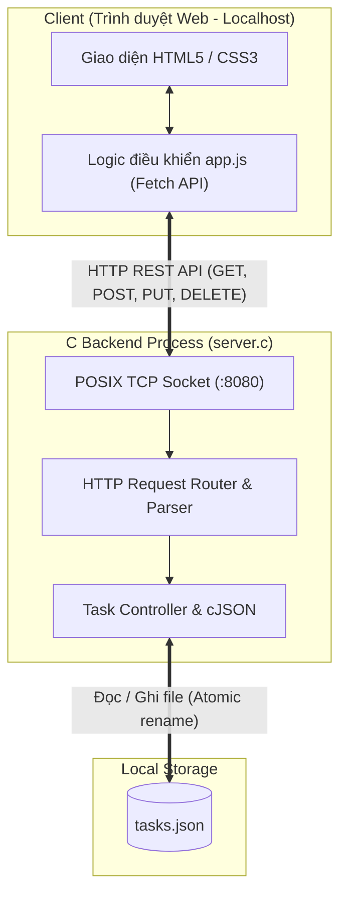

# CNPM Tuần 7: Tiến hóa kiến trúc ứng dụng quản lý công việc

Dự án cài đặt ứng dụng quản lý công việc (Task Management) tiến hóa qua 4 phiên bản kiến trúc theo yêu cầu môn **Công nghệ phần mềm** (Software Architecture Evolution).

---

## 📌 Phiên bản 1 (Version 1): Chạy cục bộ trên một máy (Local C Backend + JSON File)

### 1. Yêu cầu & Ràng buộc
- **Chức năng cố định (CRUD 4 tính năng):**
  1. Tạo task có tên (`POST /api/tasks`)
  2. Xem danh sách công việc (`GET /api/tasks`)
  3. Cập nhật trạng thái Chưa hoàn thành / Hoàn thành (`PUT /api/tasks/:id`)
  4. Xóa task (`DELETE /api/tasks/:id`)
- **Thuộc tính chất lượng (NFR):** 
  - **Data Persistence:** Dữ liệu được lưu trữ bền vững vào tệp `tasks.json`. Sau khi tắt hoặc khởi động lại ứng dụng, toàn bộ danh sách task và trạng thái vẫn được phục hồi đầy đủ.
- **Ràng buộc mới:** Chạy trên một máy cục bộ, backend tối giản bằng ngôn ngữ **C**, kết hợp giao diện Web đơn giản, hiện đại.
- **Điểm hạn chế của kiến trúc V1:** 
  - Kiến trúc nguyên khối cục bộ (Monolithic local). Toàn bộ dữ liệu nằm trong tệp `tasks.json` cục bộ, chưa hỗ trợ đồng bộ đa thiết bị hoặc nhiều người dùng qua mạng (chưa đạt Client–Server phân tán của V2).
  - Tầng giao diện, xử lý nghiệp vụ và truy xuất file JSON còn tập trung trong một process máy chủ duy nhất (chưa tách N-Layer / MVC như yêu cầu V3).
  - Đọc/ghi toàn bộ tệp JSON khi có thay đổi, chưa tối ưu hiệu năng và thiếu giao dịch (ACID).

---

## 🛠️ Công nghệ sử dụng trong Version 1
- **Ngôn ngữ Backend:** C (ANSI C / POSIX C99)
- **Networking:** POSIX Sockets (`sys/socket.h`, `netinet/in.h`), đa luồng `pthread` xử lý kết nối đồng thời.
- **Thư viện JSON:** `cJSON` (Dave Gamble - MIT License), được vendor trực tiếp không cần cài phụ thuộc bên ngoài.
- **Lưu trữ:** File `tasks.json` (sử dụng cơ chế ghi tạm `tasks.json.tmp` rồi atomic `rename` đảm bảo an toàn dữ liệu).
- **Frontend:** HTML5 ngữ nghĩa, Vanilla CSS hiện đại (Dark Glassmorphism, Responsive), Vanilla JavaScript (Async/Await Fetch API).

---

## 📁 Cấu trúc thư mục

```text
CNPM-W7-TODO/
├── Makefile                                    # Lệnh build & run backend C
├── server.c                                    # Mã nguồn C HTTP Server & REST API
├── cJSON.c                                     # Parser & Serializer JSON bằng C
├── cJSON.h                                     # Header cJSON
├── tasks.json                                  # Nơi lưu trữ dữ liệu bền vững
├── test_v1.sh                                  # Script kiểm thử tự động kịch bản V1
├── public/                                     # Thư mục giao diện Web
│   ├── index.html                              # Trang chủ giao diện quản lý task
│   ├── style.css                               # Giao diện hiện đại, glassmorphism
│   └── app.js                                  # Logic gọi API và cập nhật DOM
├── Bài tập tuần 7_ Tiến hóa... .html          # Đề bài gốc tuần 7
└── README.md                                   # Tài liệu hướng dẫn & giải thích kiến trúc
```

---

## 🚀 Hướng dẫn biên dịch & khởi chạy

### Yêu cầu môi trường
- Hệ điều hành Linux / macOS (hoặc WSL trên Windows)
- Trình biên dịch C: `gcc` hoặc `clang`
- Tiện ích: `make`, `curl`

### 1. Biên dịch mã nguồn
```bash
make clean
make
```

### 2. Khởi chạy Server
Mặc định server sẽ lắng nghe trên cổng `8080`:
```bash
./server 8080
# hoặc:
make run
```

Sau khi chạy, mở trình duyệt web truy cập:
👉 **http://localhost:8080**

---

## 🧪 Kịch bản kiểm chứng Version 1 (Rubric Verification)

Theo đúng yêu cầu của mục **04. Bảng kiểm chứng**:
> **Thao tác:** Tạo 2 task, hoàn thành 1 task, khởi động lại server.  
> **Đạt khi:** Hai task và trạng thái được khôi phục chính xác sau khi khởi động lại.

### Cách 1: Chạy kịch bản kiểm thử tự động
Chúng tôi đã cung cấp script tự động hóa toàn bộ quy trình:
```bash
chmod +x test_v1.sh
./test_v1.sh
```

Kết quả kiểm thử:
```text
===========================================================
  CNPM Week 7 - Verification Script for Version 1 (C Backend)
===========================================================
[1/7] Building C server...
[2/7] Starting C server on port 8089...
[3/7] Verifying server connectivity...
[4/7] Creating 2 tasks...
  -> Task 1: "Học lý thuyết Công nghệ phần mềm - Tuần 7" (completed: false)
  -> Task 2: "Cài đặt Version 1 với C backend và tasks.json" (completed: false)
[5/7] Marking Task 1 as completed...
  -> Task 1 updated: (completed: true)
[6/7] Stopping server to test persistence across restarts...
  -> Restarting C server on port 8089...
[7/7] Verifying tasks persistence after restart...
  [PASS] Task 1 is present and completed=true.
  [PASS] Task 2 is present and completed=false.
  [PASS] tasks.json successfully preserved state across server shutdown and restart!
===========================================================
  SUCCESS: Version 1 verification PASSED all rubric checks!
===========================================================
```

### Cách 2: Thử nghiệm thủ công trên Giao diện Web
1. Mở trình duyệt tại `http://localhost:8080`.
2. Nhập `Task 1` vào ô nhập và bấm **"Thêm công việc"**.
3. Nhập `Task 2` vào ô nhập và bấm **"Thêm công việc"**.
4. Bấm vào ô checkbox của `Task 1` để chuyển sang trạng thái **Đã hoàn thành**.
5. Mở terminal, nhấn `Ctrl + C` để tắt server.
6. Chạy lại `./server 8080`.
7. Tải lại trang web (F5) hoặc mở tab mới: Xác nhận cả 2 task và trạng thái hoàn thành của Task 1 vẫn hiển thị nguyên vẹn.

---

## 📊 Nhật ký quyết định kiến trúc (Mẫu Mục 04)

| Version | NFR mới | Quyết định thiết kế | File/thành phần đổi | Kết quả test |
| :--- | :--- | :--- | :--- | :--- |
| **V1** | **Data Persistence** trên một máy cục bộ (Dữ liệu không mất khi restart). | Xây dựng Single-Process C Backend với POSIX Sockets phục vụ REST API + Static Files; đọc/ghi dữ liệu vào `tasks.json` an toàn bằng `cJSON` và atomic rename. | `server.c`, `cJSON.c`, `cJSON.h`, `Makefile`, `public/index.html`, `public/style.css`, `public/app.js`, `tasks.json`. | Đạt: Tạo 2 task, cập nhật 1 task, tắt và khởi động lại server dữ liệu được khôi phục 100%. |

---

## 📐 Sơ đồ kiến trúc Version 1



---

## 💡 Trả lời câu hỏi kiến trúc mục 03 (V1)
> **Câu hỏi trước khi giao agent:** *Chức năng đã chạy. Thiết kế hiện tại đủ cho tình huống nào?*
- **Trả lời:** Thiết kế hiện tại của Version 1 hoàn toàn đáp ứng tốt cho **tình huống người dùng cá nhân (Single-user, Single-device)** làm việc trên một máy tính cục bộ offline, cần lưu trữ trạng thái công việc bền vững qua các lần tắt mở ứng dụng.
- **Giới hạn cần tiến hóa ở V2:** Khi có yêu cầu hai hoặc nhiều người cùng cộng tác trên các thiết bị/trình duyệt khác nhau, kiến trúc cục bộ này cần được mở rộng kết nối mạng tập trung (Client–Server) với backend mở cho các IP trong mạng và cơ chế đồng bộ trạng thái giữa các client.