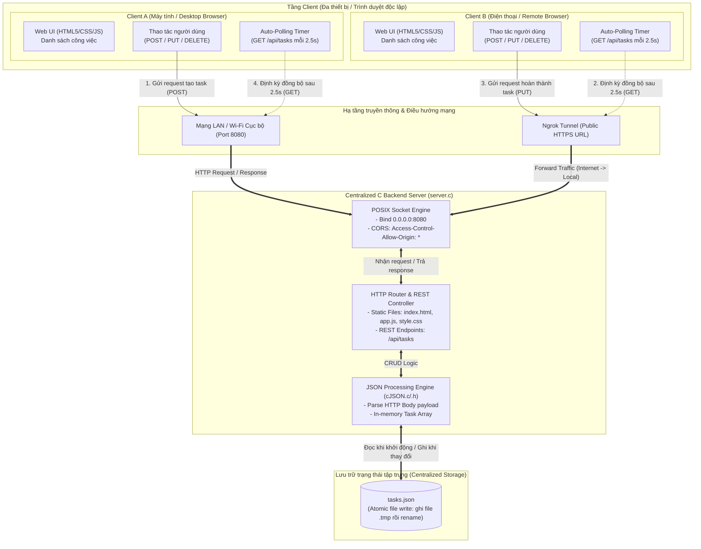
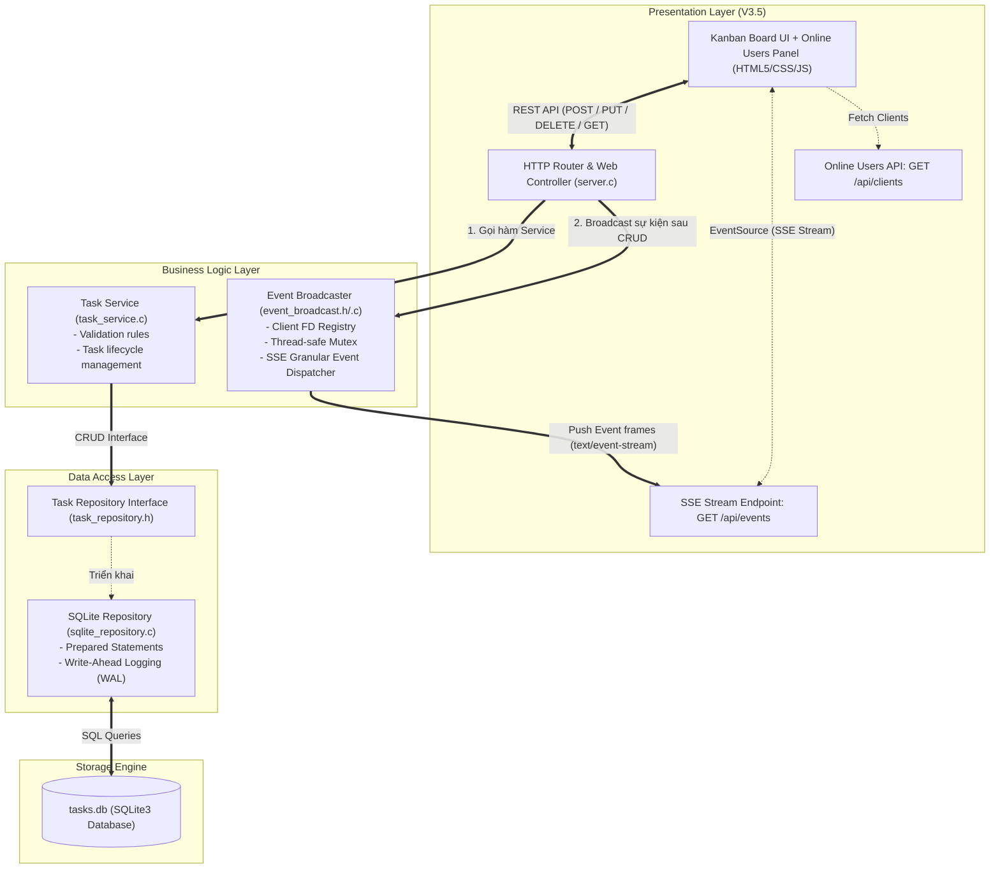
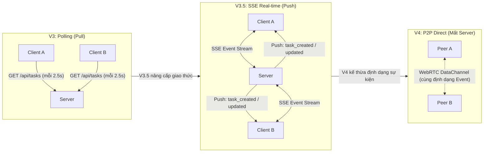
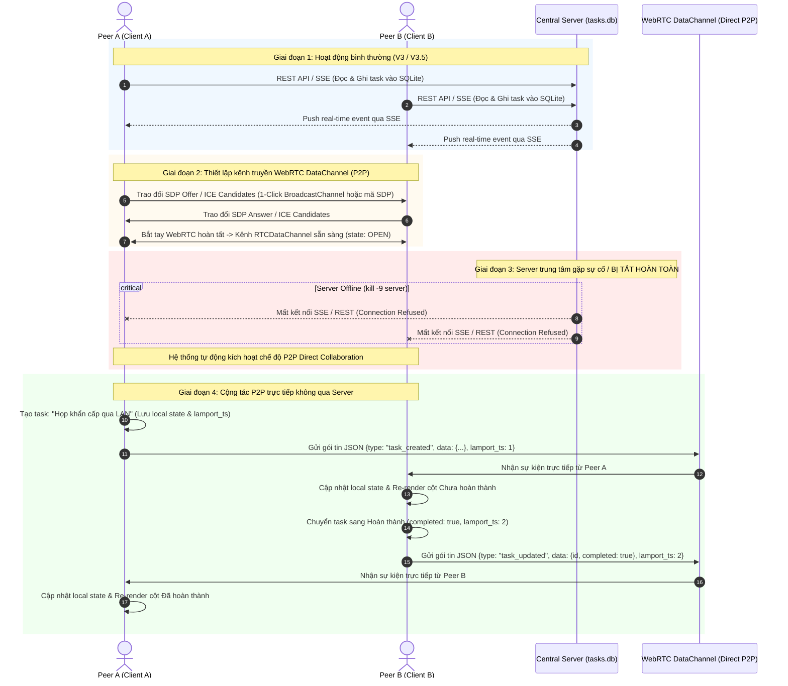

# CNPM Tuần 7: Tiến hóa kiến trúc ứng dụng quản lý công việc

>[!WARNING] chú ý
> Các hướng dẫn bên dưới được thực hiện trên môi trường linux dùng shell zsh. 
## 📌 Tổng quan các phiên bản

| Phiên bản | Mô hình kiến trúc | Phạm vi triển khai & Lưu trữ | Trạng thái |
| :--- | :--- | :--- | :--- |
| **V1** | Standalone Local Process | Chạy cục bộ 1 máy, file `tasks.json` | ✅ Hoàn thành (`tag: v1.0`) |
| **V2** | Client–Server (Centralized State) | Nhiều client kết nối chung 1 C server qua LAN / Ngrok Tunnel | ✅ Hoàn thành (`tag: v2.0`) |
| **V3** | N-Layer & Kanban Board | Tách 3 tầng (Presentation / Service / Repository), Database SQLite3 | ✅ Hoàn thành (`tag: v3.0`) |
| **V3.5** | **N-Layer + SSE Real-time Collaboration** | **Thay HTTP Polling bằng Server-Sent Events; nhận biết người dùng online** | ✅ **Hoàn thành (`tag: v3.5`)** |
| **V4** | **Peer-to-Peer (P2P Direct Collaboration)** | **WebRTC DataChannel: Đồng bộ ngang hàng trực tiếp khi mất server trung tâm** | ✅ **Hoàn thành (`tag: v4.0`)** |

---

## 🚀 Hướng dẫn khởi chạy & Kiểm chứng

### 1. Khởi chạy C Backend & Ngrok Tunnel
```bash
./start_ngrok.sh
```

### 2. Kiểm chứng tự động từng phiên bản
```bash
# Kiểm chứng Version 1 (Persistence trên tasks.json)
./test_v1.sh

# Kiểm chứng Version 2 (Client A và Client B đa thiết bị)
./test_v2.sh

# Kiểm chứng Version 3 (N-Layer, SQLite Migration & Kanban)
./test_v3.sh

# Kiểm chứng Version 3.5 (SSE Real-time, Online Users)
./test_v3_5.sh

# Kiểm chứng Version 4 (P2P WebRTC DataChannel, Lamport Clock, Offline Fallback)
./test_v4.sh
```
### 3. Kiểm chứng thủ công từng phiên bản 
```bash
# Chuyển sang commit của phiên bản tương ứng
git checkout <mã hash của commit>
# ví dụ chuyển sang version 1
git checkout 8ce80dbf8b96de7f11805a6f0a82f6155f2700af
# Để chuyển lại bản chính 
git switch main 
```
---

## 📊 Nhật ký quyết định kiến trúc 

| Version | NFR mới | Quyết định thiết kế | File/thành phần đổi | Kết quả test |
| :--- | :--- | :--- | :--- | :--- |
| **V1** | **Data Persistence** trên một máy cục bộ (Dữ liệu không mất khi restart). | Xây dựng Single-Process C Backend với POSIX Sockets phục vụ REST API + Static Files; đọc/ghi dữ liệu vào `tasks.json` an toàn bằng `cJSON` và atomic rename. | `server.c`, `cJSON.c`, `cJSON.h`, `Makefile`, `public/index.html`, `public/style.css`, `public/app.js`, `tasks.json`. | Đạt: Tạo 2 task, cập nhật 1 task, tắt và khởi động lại server dữ liệu được khôi phục 100%. |
| **V2** | **Centralized Shared State** giữa nhiều client đồng thời qua mạng. | Cấu hình C Server bind `0.0.0.0`, mở rộng CORS; chuyển tiếp port qua **Ngrok Tunnel** ra Internet; bổ sung cơ chế **Auto-Polling (2.5s)** trên Frontend để đồng bộ hai chiều giữa các client. | `server.c`, `public/index.html`, `public/style.css`, `public/app.js`, `start_ngrok.sh`, `test_v2.sh`. | Đạt: Client A tạo task, Client B thấy sau 2.5s; Client B hoàn thành task, Client A thấy ngay trạng thái mới. |
| **V3** | **Modifiability** & **Separation of Concerns** (Tách Presentation, Business Logic, Data Access; hỗ trợ ACID database). | Áp dụng mô hình **N-Layer**: Tách `task_service` (nghiệp vụ) và `sqlite_repository` (Data Access SQLite3); chuyển đổi giao diện sang **Kanban 2 cột** (Drag & Drop); tự động migrate dữ liệu từ `tasks.json` sang `tasks.db`. | `task_repository.h`, `sqlite_repository.c`, `task_service.h`, `task_service.c`, `server.c`, `Makefile`, `public/index.html`, `public/style.css`, `public/app.js`, `test_v3.sh`. | Đạt: Toàn bộ task cũ từ V2 được chuyển sang SQLite không mất mát; kéo thả chuyển cột Kanban mượt mà; tắt mở lại server dữ liệu SQLite toàn vẹn. |
| **V3.5** | **Real-time Collaboration & Multi-User Awareness** (Cộng tác thời gian thực tức thì <50ms; giảm tải băng thông mạng; nhận biết người dùng online; tiền đề event stream cho P2P V4). | Thay thế HTTP Polling bằng **Server-Sent Events (SSE)** tại `GET /api/events` và `GET /api/clients`; xây dựng module `event_broadcast.c/.h` đa luồng (`pthread_mutex_t`) quản lý kết nối client và broadcast các sự kiện granular (`task_created`, `task_updated`, `task_deleted`, `client_joined`, `client_left`); Frontend cập nhật DOM trực tiếp theo event (không cần load lại toàn bộ danh sách); hỗ trợ tự động fallback sang polling nếu mất kết nối SSE. | `event_broadcast.h`, `event_broadcast.c`, `server.c`, `Makefile`, `public/app.js`, `public/index.html`, `public/style.css`, `test_v3_5.sh`. | Đạt: 11/11 bài test tự động (`test_v3_5.sh`). Client A thêm/sửa/xóa task thì Client B nhận event SSE tức thì; nhận biết chính xác số người dùng online; kiểm tra hồi quy V1, V2, V3 đều vượt qua 100%. |
| **V4** | **High Availability & Decentralized Fault Tolerance** (Vận hành không gián đoạn khi server trung tâm sập; chia sẻ và đồng bộ trực tiếp giữa 2 thiết bị trong LAN). | Bổ sung đường truyền P2P qua **WebRTC DataChannel** (`RTCPeerConnection`); hỗ trợ 2 chế độ: **1-Click Local Tab Sync** (qua `BroadcastChannel` cho 2 tab thử nghiệm) và **Manual SDP Token Exchange** (cho 2 máy LAN độc lập không cần server); tái sử dụng Granular Event Protocol từ V3.5; bổ sung cơ chế **Last-Write-Wins (LWW) kết hợp Lamport Logical Timestamp** để hòa giải xung đột dữ liệu; tự động chuyển tiếp CRUD sang DataChannel khi phát hiện server offline. | `public/app.js`, `public/index.html`, `public/style.css`, `server.c` (`/api/info`), `test_v4.sh`, `README.md`. | Đạt: 10/10 bài test tự động (`test_v4.sh`). Kết nối P2P giữa hai client; tắt hoàn toàn C backend server (`kill -9`); Client A tạo task &rarr; Client B nhận được ngay; Client B đổi trạng thái &rarr; Client A nhận được ngay khi server đã chết 100%. |

---

## 📐 Sơ đồ kiến trúc Version 2 (Client–Server & HTTP Polling)



---

## 📐 Sơ đồ kiến trúc Version 3.5 (N-Layer + SSE Real-time Broadcast)



### So sánh kiến trúc V3 (Polling) vs V3.5 (SSE) vs V4 (P2P Tiền đề)



---

### Sơ đồ luồng kết nối Version 4 (Mermaid)



---

### Hướng dẫn kiểm chứng P2P khi tắt hoàn toàn Server

1. **Khởi động server:**
   ```bash
   ./server
   ```
2. **Mở 2 cửa sổ / tab trình duyệt:**
   - Tab 1: [http://localhost:8080](http://localhost:8080) (Định danh ví dụ: *Thiết bị A*)
   - Tab 2: [http://localhost:8080](http://localhost:8080) (Định danh ví dụ: *Thiết bị B*)
3. **Bật kết nối P2P:**
   - Sử dụng mã thủ công SDP và copy paste đúng các ô theo giao diện hướng dẫn sau đó bấm `hoàn tất kết nối`.
   - Cả hai tab sẽ chuyển trạng thái đèn tín hiệu sang: `P2P: Trực tiếp (DataChannel) ✓` (màu tím).
4. **TẮT HOÀN TOÀN SERVER BACKEND:**
   - Chạy lệnh dưới đây trong terminal hoặc nhấn ^C:
     ```bash
     pkill -9 server
     ```
   - Quan sát trên cả 2 tab: Đèn Server Status chuyển sang màu đỏ: `Mất kết nối server (Offline)`.
   - Lưu ý: **Server C và toàn bộ tiến trình backend đã chết 100%**.
5. **Kiểm chứng chiều A &rarr; B:**
   - Trên Tab 1 (Peer A), nhập tiêu đề task: `Task tạo khi server đã chết` &rarr; Bấm **"Thêm công việc"**.
   - **Kết quả:** Thẻ task xuất hiện ngay lập tức trên cột *Chưa hoàn thành* của Tab 2 (Peer B) kèm nhãn `#ID (P2P)` và toast thông báo: `📡 [P2P] Nhận task mới từ Peer`.
6. **Kiểm chứng chiều B &rarr; A:**
   - Trên Tab 2 (Peer B), bấm nút **"Hoàn thành"** trên task vừa nhận.
   - **Kết quả:** Thẻ task trên Tab 1 (Peer A) tự động chuyển sang cột *Đã hoàn thành* ngay tức khắc!

## Cách sử dụng coding agent và prompt 
- model sử dụng chính: gemini 3.8
- Quy trình sử dụng: đầu tiền tải file "Bài tập tuần 7" vàp ngữ cảnh. Sau đó dùng skill `plan` để kế hoạch thực thi cho từng version. Sau khi duyệt thì bắt đầu thực thi rồi kiểm tra lại. Trước mỗi phiên bản, viết một câu về ràng buộc mới và một câu về điểm hạn chế của thiết kế hiện tại.
- Prompt chính: hãy dùng skill /plan để tạo cho tôi kế hoạch thực thi version X trong file @Bài-tập-tuần-7. Không tự ý thực thi các version còn lại. Phải cập nhật README, bảng nhật kí quyết định và sơ đồ kiến trúc nếu cần. Không thực thi ngoài phạm vi yêu cầu. Sửa code hiện có, không tạo project thứ hai.
