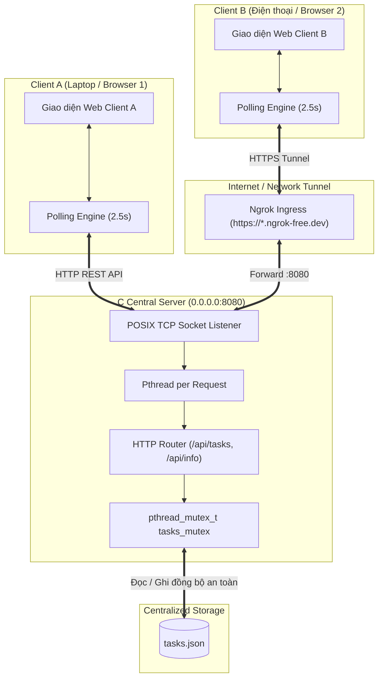

# CNPM Tuần 7: Tiến hóa kiến trúc ứng dụng quản lý công việc

Dự án cài đặt ứng dụng quản lý công việc (Task Management) tiến hóa qua các phiên bản kiến trúc theo yêu cầu môn **Công nghệ phần mềm** (Software Architecture Evolution).

---

## 📌 Tổng quan các phiên bản

| Phiên bản | Mô hình kiến trúc | Phạm vi triển khai & Lưu trữ | Trạng thái |
| :--- | :--- | :--- | :--- |
| **V1** | Standalone Local Process | Chạy cục bộ 1 máy, file `tasks.json` | ✅ Hoàn thành (`tag: v1.0`) |
| **V2** | Client–Server (Centralized State) | Nhiều client kết nối chung 1 C server qua LAN / Ngrok Tunnel | ✅ Hoàn thành (`tag: v2.0`) |
| **V3** | N-Layer & MVC / MVVM | Tách tầng Presentation/Service/Repository, đổi sang SQLite | ⏳ Tiếp theo |
| **V4** | Peer-to-Peer (P2P Direct Sync) | Đồng bộ ngang hàng khi mất server trung tâm | ⏳ Tiếp theo |

---

## 🚀 Hướng dẫn nhanh khởi chạy Version 2

### 1. Khởi chạy C Backend & Ngrok Tunnel (Cho phép máy khác truy cập)
Chạy script tích hợp sẵn:
```bash
./start_ngrok.sh
```
Script sẽ tự động:
1. Biên dịch C Backend (nếu chưa build).
2. Chạy server lắng nghe trên tất cả các card mạng `0.0.0.0:8080`.
3. Bật tunnel `ngrok` công khai ra Internet và in đường dẫn URL ra màn hình, ví dụ:
   - **Local URL:** `http://localhost:8080`
   - **Ngrok Public URL:** `https://kiera-keratometric-varietally.ngrok-free.dev`

### 2. Kiểm chứng tự động (Automated Rubric Test)
Chạy script kiểm tra kịch bản 2 client thao tác chéo:
```bash
./test_v2.sh
```

---

## 🏛️ Chi tiết kiến trúc Version 2: Client–Server & Multi-Device Collaboration

### 1. Yêu cầu & Ràng buộc theo đề bài
- **Yêu cầu khách hàng:** Hai người mở ứng dụng trên hai thiết bị hoặc hai trình duyệt riêng. Mỗi người phải thấy các công việc được cập nhật từ người kia.
- **Thuộc tính chất lượng (NFR):**
  - **Shared Centralized State:** Trạng thái chia sẻ tập trung giữa nhiều client thông qua backend trung tâm.
  - **Concurrency & Freshness:** Hỗ trợ đồng thời nhiều client đọc/ghi; dữ liệu phản ánh cập nhật mà không cần tải lại thủ công.
- **Ràng buộc mới của V2:**
  - Backend C mở lắng nghe `0.0.0.0:8080` (thay vì chỉ `127.0.0.1`).
  - Hỗ trợ đường truyền mạng công khai qua **Ngrok Tunnel** để thiết bị khác ngoài Internet (như điện thoại, laptop khác) truy cập trực tiếp.
  - Client bổ sung cơ chế **Auto-Polling định kỳ (2.5 giây)**: Tự động so sánh dữ liệu mới từ server để cập nhật DOM mượt mà, thông báo khi có thay đổi từ thiết bị khác.
- **Điểm hạn chế của thiết kế V2:**
  - **Single Point of Failure (SPOF):** Toàn bộ hệ thống phụ thuộc hoàn toàn vào máy chủ trung tâm. Nếu C server hoặc đường truyền Ngrok ngắt kết nối, tất cả client không thể đọc, ghi hay cập nhật bất kỳ task nào.
  - **Overhead của Polling:** Polling định kỳ tạo các request lặp lại ngay cả khi không có dữ liệu thay đổi.
  - **Chưa tách lớp (Coupling):** Code backend C vẫn trộn lẫn giữa nhận request HTTP, kiểm tra nghiệp vụ và đọc/ghi file `tasks.json` (sẽ được tái cấu trúc N-Layer ở V3).

---

## 🧪 Kịch bản kiểm chứng Version 2 (Rubric Check)

Theo đúng yêu cầu của mục **04. Bảng kiểm chứng**:
> **Thao tác:** A tạo task, B xem; B cập nhật, A xem.  
> **Đạt khi:** Hai client quan sát cùng dữ liệu server.

### 1. Kiểm thử tự động (`./test_v2.sh`)
```text
===========================================================
  CNPM Week 7 - Verification Script for Version 2 (Client-Server)
===========================================================
[1/8] Rebuilding C server...
[2/8] Starting C server on port 8088...
[3/8] Checking V2 server connectivity and /api/info...
  -> Server Info: {"version":"V2","architecture":"Client-Server (Multi-Client)","storage":"tasks.json","task_count":0}
[4/8] [Client A (Máy tính)] Tạo task mới...
  -> Client A tạo thành công: Task #1: "Họp thiết kế kiến trúc Client-Server"
[5/8] [Client B (Điện thoại)] Đọc danh sách task từ server trung tâm...
  -> Client B quan sát thấy: Task #1 của Client A (completed: false)
  [PASS] Client B đã quan sát thấy task của Client A.
[6/8] [Client B (Điện thoại)] Đánh dấu hoàn thành task ID #1...
  -> Client B cập nhật thành công: (completed: true)
[7/8] [Client A (Máy tính)] Tải lại / nhận dữ liệu polling từ server...
  -> Client A quan sát thấy: Task #1 (completed: true)
  [PASS] Client A đã thấy trạng thái mới (completed: true) do Client B thực hiện.
[8/8] [Client B] Tạo thêm task phản hồi và Client A xác nhận đồng bộ...
  [PASS] Đồng bộ hai chiều giữa Client A và Client B hoạt động hoàn hảo trên server trung tâm!
===========================================================
  SUCCESS: Version 2 verification PASSED all rubric checks!
===========================================================
```

### 2. Thử nghiệm thực tế với 2 thiết bị qua Ngrok
1. Chạy `./start_ngrok.sh`, lấy URL công khai (ví dụ: `https://...ngrok-free.dev`).
2. **Thiết bị 1 (Laptop):** Mở trình duyệt tại URL trên (giao diện hiển thị badge `Thiết bị A`).
3. **Thiết bị 2 (Điện thoại hoặc Trình duyệt ẩn danh):** Mở cùng URL trên (giao diện hiển thị badge `Thiết bị B`).
4. Trên Thiết bị 1: Nhập task mới và bấm **"Thêm công việc"**.
5. Nhìn sang Thiết bị 2: Sau 2.5s, task mới xuất hiện kèm toast thông báo tự động.
6. Trên Thiết bị 2: Bấm vào checkbox để hoàn thành task.
7. Nhìn lại Thiết bị 1: Task tự động gạch ngang chuyển sang màu xanh hoàn thành.

---

## 📊 Nhật ký quyết định kiến trúc (Mẫu Mục 04)

| Version | NFR mới | Quyết định thiết kế | File/thành phần đổi | Kết quả test |
| :--- | :--- | :--- | :--- | :--- |
| **V1** | **Data Persistence** trên một máy cục bộ (Dữ liệu không mất khi restart). | Xây dựng Single-Process C Backend với POSIX Sockets phục vụ REST API + Static Files; đọc/ghi dữ liệu vào `tasks.json` an toàn bằng `cJSON` và atomic rename. | `server.c`, `cJSON.c`, `cJSON.h`, `Makefile`, `public/index.html`, `public/style.css`, `public/app.js`, `tasks.json`. | Đạt: Tạo 2 task, cập nhật 1 task, tắt và khởi động lại server dữ liệu được khôi phục 100%. |
| **V2** | **Centralized Shared State** giữa nhiều client đồng thời qua mạng; tính tươi mới (Freshness). | Cấu hình C Server bind `0.0.0.0`, mở rộng CORS; chuyển tiếp port qua **Ngrok Tunnel** ra Internet; bổ sung cơ chế **Auto-Polling (2.5s)** trên Frontend để đồng bộ hai chiều giữa các client. | `server.c` (CORS, Cache-Control, `/api/info`), `public/index.html`, `public/style.css`, `public/app.js` (Smart Polling, Client ID, Share link), `start_ngrok.sh`, `test_v2.sh`. | Đạt: Client A tạo task, Client B thấy sau 2.5s; Client B hoàn thành task, Client A thấy ngay trạng thái mới. |

---

## 📐 Sơ đồ kiến trúc Version 2 (Client–Server)



---

## 💡 Trả lời câu hỏi kiến trúc mục 03 (V2)
> **Câu hỏi trước khi giao agent:** *Dữ liệu đang nằm ở đâu? Nếu tắt server, client còn thực hiện được chức năng nào?*
- **Dữ liệu đang nằm ở đâu:** Toàn bộ dữ liệu nằm tập trung tại máy chủ trung tâm trong tệp `tasks.json`. Các client chỉ lưu cache tạm thời trong bộ nhớ của trình duyệt để hiển thị giao diện.
- **Nếu tắt server:** Client **không thể thực hiện được bất kỳ chức năng nào** (không thể tạo task mới, không thể xem danh sách cập nhật, không thể đổi trạng thái hoàn thành và không thể xóa). Client sẽ nhận lỗi mất kết nối mạng và giao diện chuyển sang trạng thái offline. Đây chính là điểm hạn chế lớn nhất của mô hình Client–Server tập trung, tạo tiền đề để nâng cấp tính sẵn sàng ở **Version 4 (P2P collaboration)**.